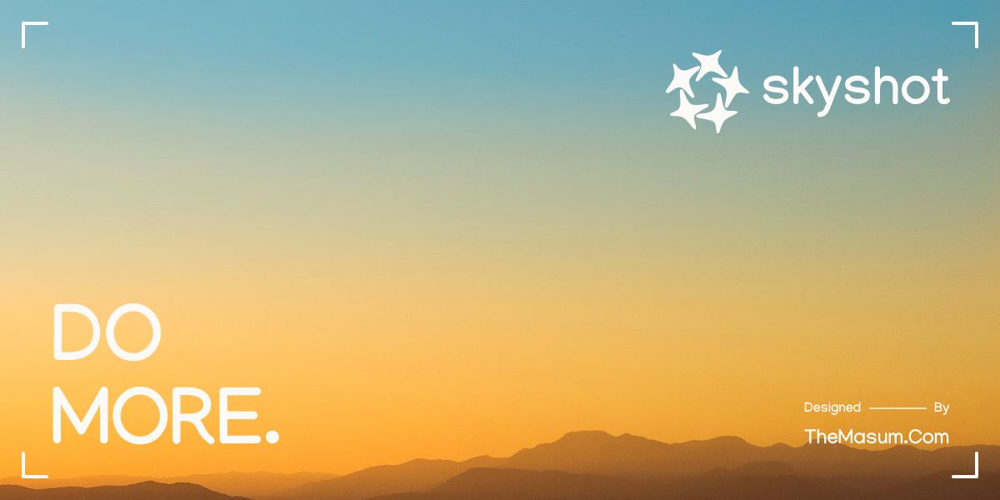
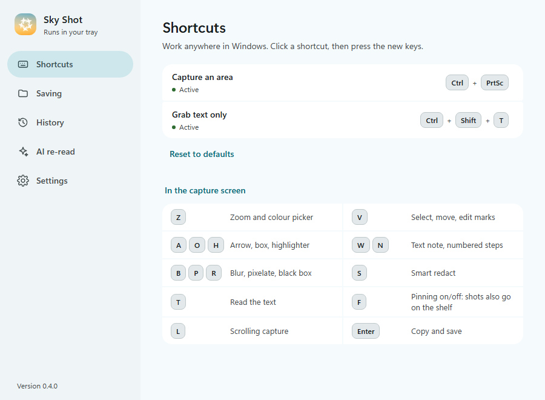
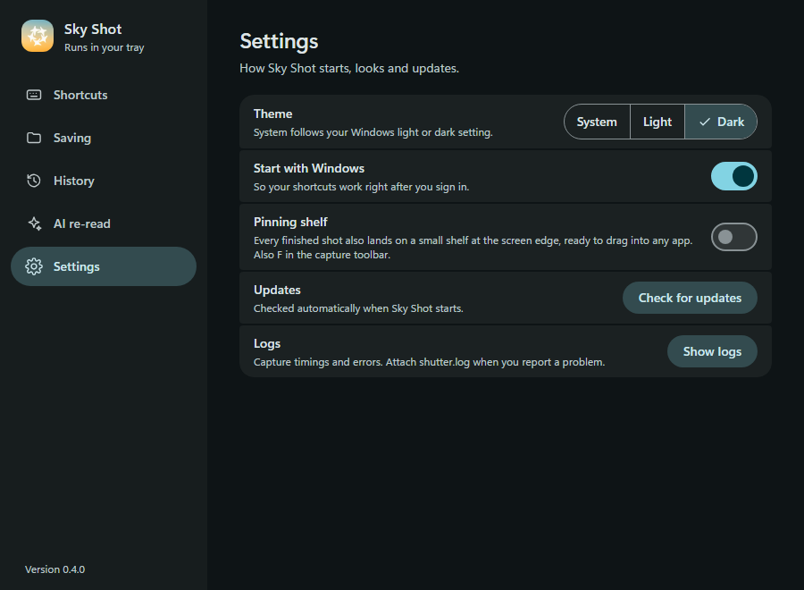
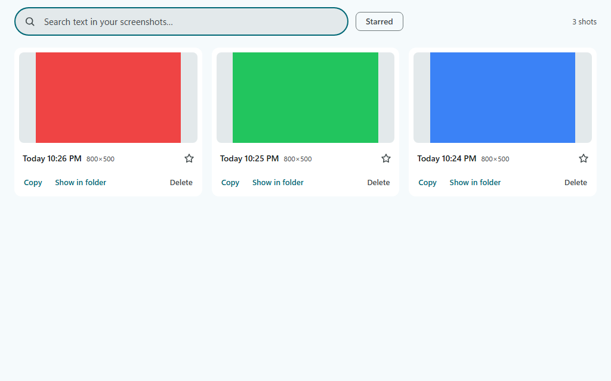
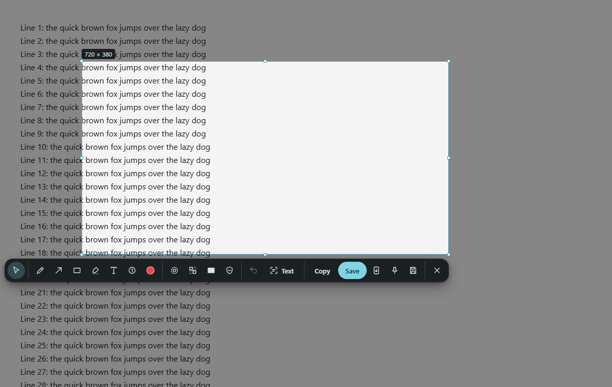

<div align="center">
  

  <h1>Sky Shot</h1>

  <p><strong>Fast, private, cross-platform screenshot capture, redaction, and offline OCR.</strong><br /><sub>Formerly Shutter — built with Tauri 2, Rust, and TypeScript.</sub></p>

  <p>
    <a href="https://github.com/zahidhossin39/SkyShot/releases/latest">
      
    </a>
    <a href="https://github.com/zahidhossin39/SkyShot/actions/workflows/check.yml">
      
    </a>
    <a href="LICENSE">
      
    </a>
    
    
  </p>

  <p>
    <a href="#install">Install</a> ·
    <a href="#features">Features</a> ·
    <a href="#preview">Preview</a> ·
    <a href="#shortcuts">Shortcuts</a> ·
    <a href="#run-from-source">Run from Source</a> ·
    <a href="#credits">Credits</a>
  </p>
</div>

---

## Install

| System | One-step install |
|---|---|
| **Windows 10 / 11** | Download `Sky.Shot_x.y.z_x64-setup.exe` from [Releases](https://github.com/zahidhossin39/SkyShot/releases/latest) and run it |
| **macOS 10.15+** *(Apple Silicon & Intel)* | `brew install --cask zahidhossin39/tap/skyshot` |
| **macOS or Linux** | `curl -fsSL https://raw.githubusercontent.com/zahidhossin39/SkyShot/main/install.sh \| sh` |

The install script automatically picks the right package for your distro: `.deb` on Debian, Ubuntu, Mint, and Pop!_OS; `.rpm` on Fedora and openSUSE; and the self-updating AppImage everywhere else (Arch, immutable distros). All installers and archives are also available on the [Releases](https://github.com/zahidhossin39/SkyShot/releases/latest) page.

Sky Shot updates itself on Windows, macOS, and AppImage via **Settings → Check for updates**. For `.deb` or `.rpm` installs, re-run the install script to upgrade.

<details>
<summary><strong>macOS & Linux setup notes</strong></summary>

- **macOS:** Your first capture prompts for **Screen Recording** permission (**System Settings → Privacy & Security**). Sky Shot isn't notarized yet: if you open the `.dmg` manually, macOS blocks it once — go to **Privacy & Security** and click **Open Anyway**. Homebrew and `install.sh` skip that step.
- **Linux:** The CLI command is `skyshot`. On Wayland, apps cannot register global hotkeys directly — add a shortcut in your desktop's keyboard settings that runs `skyshot --capture`. GNOME prompts once for screenshot permission, and its tray icon requires the **AppIndicator** extension.

</details>

---

## Features

- **Capture & Window Snap** — Press `Ctrl+PrtSc` to freeze all monitors cleanly (multi-monitor & mixed-DPI aware). Hover any window to snap to it on Windows/macOS, or drag any region.
- **Blur & Smart Redact** — Drag Blur (`B`), Pixelate (`P`), or Solid Black Box (`R`) over sensitive content; redactions are permanently burned into exported pixels. **Smart Redact** (`S`) uses on-device OCR to flag emails, phone numbers, card numbers, IP addresses, and API tokens for one-click review.
- **Offline OCR & Live Text** — Press `Ctrl+Shift+PrtSc` for instant text grab or `T` in capture to read text locally (Windows OCR, Apple Vision, or `ocrs` on Linux). Select words directly on the image via **Live Text**, trigger one-click URL/email/phone chips, or optionally use **AI re-read** with your own Claude or Gemini API key for handwriting and blurry text.
- **Annotations & Pressure-Sensitive Pen** — Freehand ink (`D`) powered by `perfect-freehand` with tablet pressure sensitivity and hold-to-snap lines/boxes/ellipses, plus arrows (`A`), boxes (`O`), multiply-blend highlighter (`H`), editable text notes (`W`), numbered steps (`N`), 12 preset colours + custom picker, and thickness/opacity controls.
- **Pinning Shelf** — Toggle **Pinning** (`F` or tray menu) to dock every finished shot onto a compact screen-edge shelf, ready to drag directly into any app.
- **Scrolling Capture** — Press `L` to auto-scroll and stitch long web pages, chats, and documents into one tall image while ignoring sticky footers and composers.
- **Zoom Loupe & Colour Picker** — Toggle an 8× magnifier (`Z`) showing pixel coordinates and copyable hex colours (`C`).
- **Searchable History** — Browse past captures and search them by the OCR text inside them, with starring and configurable retention.
- **Material Design 3 UI** — Clean, minimal Light, Dark, and System themes with tray integration, global hotkey rebinding, autostart, and built-in updates.

---

## Preview

<table>
  <tr>
    <td align="center" width="50%">
      <br />
      <sub><strong>Settings & Shortcuts</strong> — Light Mode (Material Design 3)</sub>
    </td>
    <td align="center" width="50%">
      <br />
      <sub><strong>General Settings</strong> — Dark Mode (Material Design 3)</sub>
    </td>
  </tr>
  <tr>
    <td align="center" width="50%">
      <br />
      <sub><strong>Searchable History</strong> — OCR Text Search & Starring</sub>
    </td>
    <td align="center" width="50%">
      <br />
      <sub><strong>Capture Overlay</strong> — In-Place Edit & Redact Toolbar</sub>
    </td>
  </tr>
</table>

---

## Shortcuts

<details>
<summary><strong>Quick reference — global hotkeys and capture screen keys</strong></summary>

### Global hotkeys *(rebindable in Settings)*

| Shortcut | Action |
|---|---|
| `Ctrl+PrtSc` | Capture an area |
| `Ctrl+Shift+PrtSc` | Grab text only (instant OCR to clipboard) |

### In the capture screen

| Key | Action | Key | Action |
|---|---|---|---|
| `Z` | Zoom loupe and colour picker | `B` | Blur |
| `V` | Select, move, edit marks | `P` | Pixelate |
| `D` | Draw (freehand pen; hold to snap) | `R` | Black box |
| `A` | Arrow | `S` | Smart redact |
| `O` | Box outline | `T` | Read the text (OCR & Live Text) |
| `H` | Highlighter | `F` | Pinning on/off (send shots to shelf) |
| `W` | Text note | `L` | Scrolling capture |
| `N` | Numbered steps | `Enter` | Copy and save |

</details>

---

## Run from Source

Prerequisites: [Node.js](https://nodejs.org) (24+), [Rust](https://rustup.rs) (stable), and the [Tauri 2 prerequisites](https://v2.tauri.app/start/prerequisites/) for your OS. On Linux, fetch the offline OCR models once before building: `sh scripts/get-ocr-models.sh`.

```powershell
npm install
npm run tauri dev
```

- **Build installer:** `npm run tauri build`
- **Run tests:** `npm test` (TypeScript) and `cargo test` inside `src-tauri`
- **Full check:** `npm run check` (`tsc`, JS tests, `cargo clippy`, and Rust unit tests)

See [SPEC.md](SPEC.md) for architecture & design decisions, [CONTRIBUTING.md](CONTRIBUTING.md) for contributor guidelines, [CHANGELOG.md](CHANGELOG.md) for release history, and [SECURITY.md](SECURITY.md) for privacy & security details.

---

## Credits

| Collaborator | Role & Contributions | Links |
|---|---|---|
| **Zaid Hossain** | Owner. Product ideation, core engineering & desktop architecture, project rights & license holder | [ZaidHossain.Com](https://zaidhossain.com) · [@zahidhossin39](https://github.com/zahidhossin39) |
| **Masum Khan** | Naming, core feature design, UI/UX direction, visual creatives & brand logo | [TheMasum.Com](https://themasum.com) · [@8Masum](https://github.com/8Masum) |

> **Ownership & Rights:** Project rights, copyright, and license are held by **Zaid Hossain ([ZaidHossain.Com](https://zaidhossain.com))**, released under the MIT License.

---

## License

[MIT License](LICENSE) — Copyright (c) 2026 Zaid Hossain (ZaidHossain.Com)
